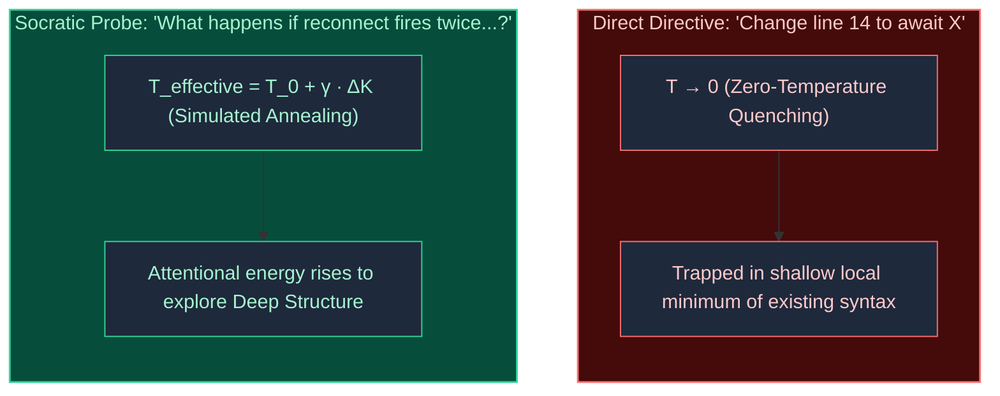
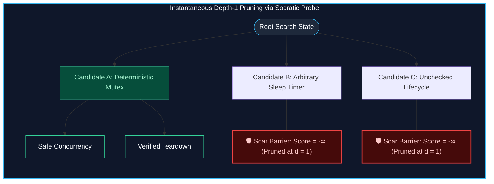

# The Physics of Socratic Prompting

This reference guides subagents on formulating Socratic probes from synthetic scars.
A Socratic probe is a targeted question prompt that guides an autonomous coding agent.
The probe forces the agent to explore deep structure and reject fatal mistakes early.

## 1. The Non-Von Neumann Computing Pond

Language models do not compute like Von Neumann processors.
They do not execute step-by-step instructions in sequential memory registers.
Instead, they compute like a pond that processes waves from a dropped pebble.
The pond represents the high-dimensional space of latent weights (stored numbers that define model connections).

When you give a direct code directive, you drop a heavy stone into the pond.
You fix a single token coordinate, but you create chaotic wakes across adjacent tokens.
The model patches the local line, but introduces a new race condition nearby.
You cannot single-step a pond.
You must reshape the shoreline.

Reinforcement learning (a training method that uses numerical rewards) often worsens this behavior.
Scalar reward scores compress complex engineering choices into simple positive or negative values.
A negative reward smears penalty values across unrelated steps of a coding task.
A positive reward can reinforce dangerous shortcuts that appear to save time.
Standard models then optimize for surface plausibility while ignoring catastrophic runtime risks.

## 2. Simulated Annealing and Kinetic Impulses

In physics, the word quenching describes rapid cooling that traps defects in a crystalline lattice.
A direct imperative directive acts like zero-temperature quenching.
It freezes the model into the shallowest local minimum of its current syntax.
The model patches the syntax without understanding the wider system lifecycle.

Simulated annealing is a search method that heats then cools a system.
Heating lets the system escape shallow local minima to find the global optimum.
A Socratic question acts as a kinetic impulse ($\Delta K$).
The question raises the effective attentional temperature:

$$T_{\text{effective}} = T_0 + \gamma \cdot \Delta K$$

This kinetic impulse forces the attention heads to climb over narrow syntax walls.
The model explores deep temporal dimensions.
It evaluates reconnection loops, dispose boundaries, and asynchronous queue states.
The result is systemic architecture rather than a superficial patch.

## 3. Alpha-Beta Pruning at Depth 1

Modern reasoning models use large token budgets to think before writing code.
Without constraints, reasoning trees grow at exponential search complexity:

$$\text{Search Complexity} = O(b^d)$$

The variable $b$ is the branching factor (the number of candidate decisions at each step).
The variable $d$ is the reasoning depth.
When constraints are absent, models waste thousands of tokens rationalizing bad architecture.

In game search, alpha-beta pruning is an algorithm that cuts doomed search branches.
When an engine detects a path that loses a queen, it assigns a score of $-\infty$.
The engine does not search deeper.
It prunes the entire branch at depth $d = 1$.

A synthetic scar acts as an alpha-beta cutoff barrier:

$$\text{Candidate Plan} \cap \text{Trap Domain} \neq \emptyset \implies \text{Score} = -\infty \implies \text{Prune at } d = 1$$

A Socratic probe activates this barrier before the agent generates code.
The probe forces the agent to identify the fatal trap immediately.
The agent drops the doomed exploratory tree at depth 1.

## 4. The NLP Meta-Model and Linguistic Invariants

Linguistics defines two levels of communication:
Surface structure means the literal words or syntax.
Deep structure means the complete graph of meanings, actors, lifecycles, and constraints.
Language models train primarily on surface syntax.
When a model produces flawed code, it suffers from a collapse of deep structure.

The Neuro-Linguistic Programming Meta-Model identifies three primary ways that deep structure collapses:

1. Generalization:
The model treats a single pattern as a universal rule.
It adds unnecessary abstraction layers for simple tasks.

2. Deletion:
The model deletes real constraints from its plan.
It assumes that networks never fail and components never unmount.

3. Distortion:
The model creates false relationships or phantom complexity.
It wraps simple functions in useless pass-through shims.

### The Negation Defect

Never use negative prompt rules like "Do not write unawaited futures."
The attention mechanism energizes the token representations of the forbidden words.
Under heavy reasoning loads, the negation word decays first.
The energized bad pattern then leaks directly into the output.
Replace negative prohibitions with affirmative invariants.

## 5. Somatic Recoil and Inferred Intuition

Somatic recoil is a physical warning reflex from past errors.
Antonio Damasio defined this response in the Somatic Marker Hypothesis.
When an experienced engineer sees dangerous code, their body responds before conscious deduction begins.
The wince is the compressed memory of past production outages.

A synthetic scar records this intuition in three distinct parts:

1. The Wound:
The runtime failure scene, such as stack traces, data corruption, or crashes.

2. The Trap:
The seductive shortcut that standard models instinctively generate.

3. The Reflex:
The affirmative topological invariant that the code must satisfy before execution.

The Socratic probe translates this somatic recoil into an active question.
It awakens the same defensive guard in the reasoning agent.

## 6. How Subagents Formulate Socratic Probes

Subagents like `synthetic-scar-importer` convert scars into Socratic probes.
Follow these operational steps to build each probe:

1. Read the wound, trap, circuit breaker, and reflex fields of the scar.
2. Identify the fatal runtime failure described in the wound.
3. Identify the tempting shortcut described in the trap.
4. Identify the non-negotiable safety invariant described in the reflex.
5. Formulate questions that force the target agent to test its plan against the invariant.

### Probe Invariants

When you write the `socratic_probe` field, satisfy these rules:

1. Write one to three question sentences.
2. Keep each question sentence at 20 words or fewer.
3. End every question sentence with a question mark (`?`).
4. Focus only on the technical risk and the invariant reflex.
5. State questions affirmatively without negative commands.
6. If a condition applies, place the condition before the question clause.

### Example Formulations

#### Example 1: Asynchronous Lifecycle Hazard

- Wound: Unmounted widget calls `setState` when an event completes after navigation.
- Trap: The model assumes listeners finish before the component unmounts.
- Reflex: Cancel subscriptions and guard state mutations with mounted checks.
- Bad Probe (Negative directive): "Do not call setState after dispose, and do not forget to cancel."
- Good Socratic Probe: "What happens if this subscription emits an event after the user leaves the screen? Did you bind cancellation to teardown?"

#### Example 2: Sleep-Wait Race Hazard

- Wound: A test fails intermittently because `Future.delayed(100ms)` finishes before a slow database write.
- Trap: The model guesses that 100 milliseconds is sufficient time.
- Reflex: Synchronize asynchronous tasks with deterministic completers or signals.
- Bad Probe (Directive): "Use a Completer instead of a delayed timer."
- Good Socratic Probe: "What happens to this test if database latency exceeds your timer? Did you synchronize with a deterministic signal or completer?"
